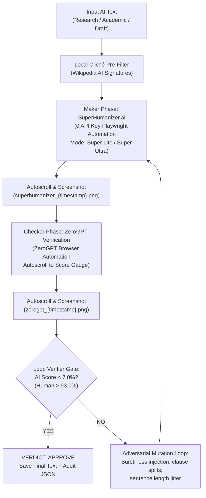

# Paraphraser Skill (Duino Deep Researcher)

Autonomous agentic skill for text humanization, adversarial anti-AI refinement, and closed-loop verification.



---

## 1. Quality Gate & Target Standards
- **Maximum AI Score**: `< 7.0% AI GPT` (ZeroGPT detector)
- **Minimum Human Style**: `> 93.0% Human`
- **Cost**: **$0.00 / 0 API Keys** (100% Free Playwright browser automation)
- **Visual Awareness**: Autoscrolls into target DOM containers and captures timestamped PNG screenshot receipts at every step.
- **Stealth Architecture**: Rotary User-Agent pool, anti-automation flags (`navigator.webdriver` removal), and proxy/rotating IP support.

---

## 2. Integrated Tooling

| Tool / Target | Role | Automation Method | Visual Receipt |
|---|---|---|---|
| **ZeroGPT** | AI Detection Gauge & Sentence Flagger | Playwright paste, detect, DOM extraction | `screenshots/zerogpt_{ts}.png` (centered on `.percentage-div`) |
| **SuperHumanizer.ai** | Neural humanizer (Super Lite / Ultra) | Clipboard paste, network interceptor | `screenshots/superhumanizer_{ts}.png` (centered on output box) |
| **Loop Verifier** | Maker / Checker Quality Enforcer | Iterative adversarial retry loop | Complete audit in `.verification.json` |

---

## 3. Usage & Execution

### CLI Command
```powershell
& "C:\Users\jalal\AppData\Local\Programs\Python\Python311\python.exe" `
  "C:\Users\jalal\.opencode\skills\Duino_Deep_Researcher\DDR\skills\paraphraser\paraphraser_cli.py" `
  --input "C:\path\to\paper.md" `
  --output "C:\path\to\paper_humanized.md" `
  --target-ai 7.0 `
  --screenshots-dir "./screenshots"
```

### Python API Integration
```python
import sys
sys.path.insert(0, r"C:\Users\jalal\.opencode\skills\Duino_Deep_Researcher\DDR\skills\paraphraser")
from paraphraser_cli import run_paraphraser

result = run_paraphraser(
    text="Your input paper or text...",
    output_path="output_humanized.md",
    target_ai=7.0,
    max_loops=4,
    screenshots_dir="./screenshots"
)

print(f"Final AI Score: {result['final_ai_score']}%")
print(f"Verdict: {result['verdict']}")
```

---

## 4. Operational Rules
1. **Never Blind**: Always autoscroll to the specific fields before and after clicking to verify state before proceeding.
2. **Never API Key**: Always use Playwright clipboard simulation, typing, and network interceptors.
3. **Loop Until Pass**: If ZeroGPT reports $\ge 7\%$, the loop verifier MUST reject the draft, apply adversarial clause mutations, and retry.
4. **Audit Evidence**: Store before/after screenshots and metrics in the project directory for provenance.
